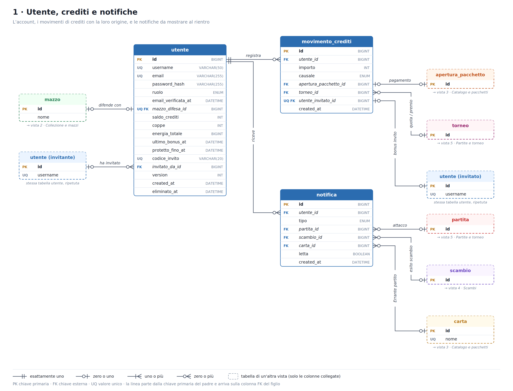
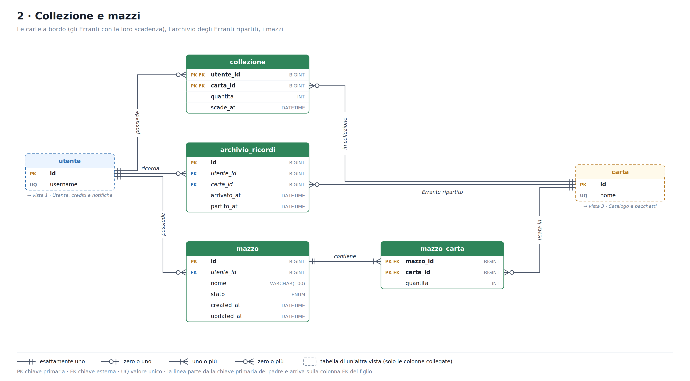
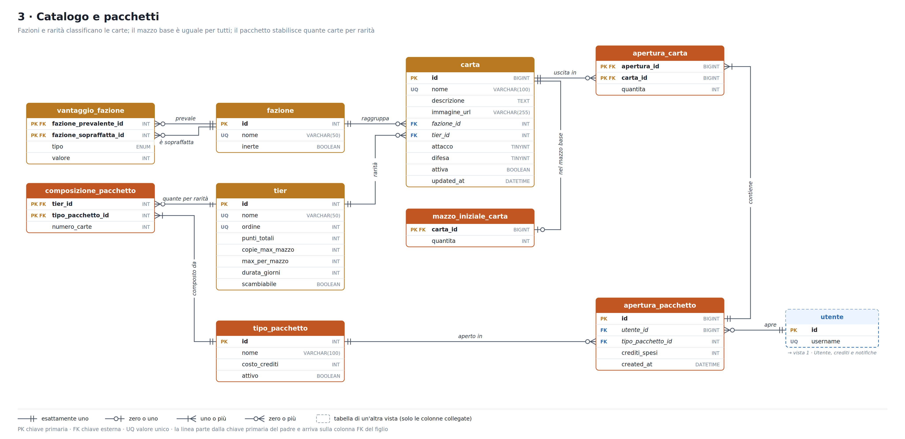
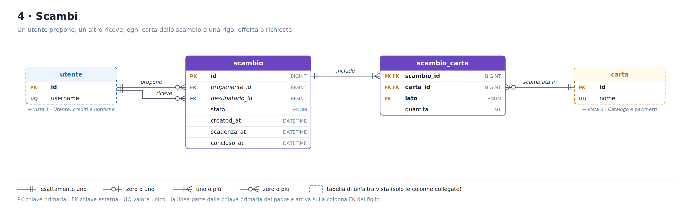
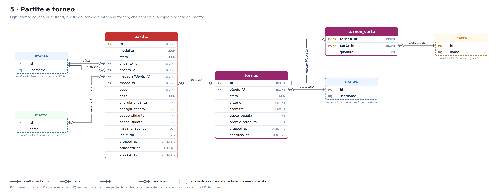
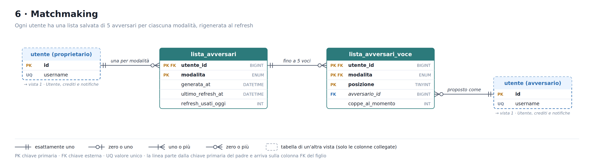
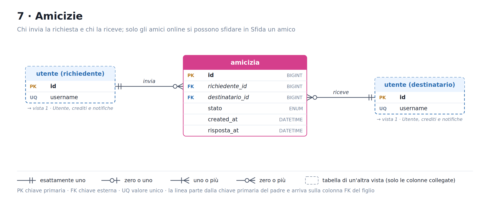

# Will of the Void – Schema del database spiegato

29 ottobre 2026 · Mondir

## Come leggere i diagrammi

Il database ha 24 tabelle su PostgreSQL, divise in 7 viste: ogni vista mostra un'area del gioco e le relazioni tra le sue tabelle, senza linee incrociate.

- **Riquadro pieno**: tabella descritta in quella vista, con tutte le colonne e i tipi.
- **Riquadro tratteggiato**: tabella descritta in un'altra vista, mostrata solo con le colonne collegate. Sotto c'è scritto in quale vista trovarla. Se dice "stessa tabella, ripetuta", è una tabella della stessa vista disegnata due volte per non incrociare le linee.
- **PK** chiave primaria, **FK** chiave esterna, **UQ** valore unico.
- **Ogni linea** parte dalla chiave primaria del padre e arriva sulla colonna FK del figlio. Il verbo sulla linea si legge come una frase: *utente possiede mazzo*.

Il simbolo a ciascuna estremità di una linea dice quante righe di quella tabella corrispondono a una riga della tabella all'altro capo:

| Simbolo | Significato |
| --- | --- |
| due stanghette | esattamente uno |
| cerchio + stanghetta | zero o uno |
| zampa + stanghetta | uno o più |
| zampa + cerchio | zero o più |

Nelle tabelle delle relazioni qui sotto, la colonna **Cardinalità** si legge da padre a figlio: "1 → 0..N" significa che a una riga del padre corrispondono zero o più righe del figlio.

## 1 · Utente, crediti e notifiche

Tutto parte da `utente`: ogni variazione del saldo crediti ha la sua origine registrata in `movimento_crediti`, e ciò che succede mentre l'utente è offline finisce in `notifica`.

| Relazione | Cardinalità | Significato |
| --- | --- | --- |
| utente → movimento_crediti.utente_id | 1 → 0..N | Ogni entrata o uscita di crediti è una riga. Il saldo in `utente` è la somma dei movimenti, aggiornato nella stessa transazione. |
| utente → notifica.utente_id | 1 → 0..N | Le notifiche da mostrare al rientro: attacchi subiti, esiti degli scambi, Erranti partiti. |
| mazzo → utente.mazzo_difesa_id | 0..1 → 0..1 | La chiave esterna sta in `utente`. Vuota = nessun mazzo di difesa, quindi l'utente non può attaccare. UNIQUE: un mazzo difende al massimo un utente. |
| utente → utente.invitato_da_id | 0..1 → 0..N | Relazione della tabella con sé stessa: chi ha invitato chi. Un utente può invitarne molti, ognuno ha al massimo un invitante. |
| apertura_pacchetto → movimento_crediti.apertura_pacchetto_id | 0..1 → 0..1 | Il pagamento di un pacchetto: un'apertura genera un solo movimento. |
| torneo → movimento_crediti.torneo_id | 0..1 → 0..N | Quota d'iscrizione e premio finale dello stesso torneo. |
| utente → movimento_crediti.utente_invitato_id | 0..1 → 0..1 | Il bonus invito, legato all'amico invitato. UNIQUE: ogni invitato fa scattare il bonus una sola volta, dopo 10 partite. |
| partita → notifica.partita_id | 0..1 → 0..N | La partita che ha generato la notifica di un attacco subito. |
| scambio → notifica.scambio_id | 0..1 → 0..N | Lo scambio accettato, rifiutato o scaduto. |
| carta → notifica.carta_id | 0..1 → 0..N | L'Errante ripartito dalla navicella. |

Tre colonne di `utente` non sono relazioni ma reggono regole del gioco: `protetto_fino_at` (protezione dopo N attacchi subiti), `ultimo_bonus_at` (bonus giornaliero) ed `eliminato_at` (soft delete: alla cancellazione username ed email vengono anonimizzati).

## 2 · Collezione e mazzi

Le carte possedute stanno in `collezione` come quantità (una riga per utente e carta), gli Erranti scaduti passano in `archivio_ricordi`, e i mazzi elencano le loro carte in `mazzo_carta`.

| Relazione | Cardinalità | Significato |
| --- | --- | --- |
| utente → collezione.utente_id | 1 → 0..N | Le carte a bordo della navicella. Le copie extra aumentano `quantita`, non creano righe nuove. |
| carta → collezione.carta_id | 1 → 0..N | La stessa carta può essere nelle collezioni di molti utenti. Con la relazione sopra forma un molti a molti tra utenti e carte. |
| utente → archivio_ricordi.utente_id | 1 → 0..N | Gli Erranti ripartiti di quell'utente: visibili ma non giocabili. |
| carta → archivio_ricordi.carta_id | 1 → 0..N | Lo stesso Errante può partire e tornare più volte: ogni passaggio è una riga, per questo la chiave è un `id`. |
| utente → mazzo.utente_id | 1 → 0..N | Un utente salva tutti i mazzi che vuole; ogni mazzo ha un solo proprietario. |
| mazzo → mazzo_carta.mazzo_id | 1 → 1..N | Le carte del mazzo con le loro copie. Cancellando il mazzo si cancellano anche le sue righe. |
| carta → mazzo_carta.carta_id | 1 → 0..N | Una carta può comparire in molti mazzi. Con la relazione sopra forma un molti a molti tra mazzi e carte. |

Il ciclo di un Errante usa due tabelle. Trovato in un pacchetto, entra in `collezione` con `scade_at` a 7 giorni; se viene ritrovato mentre è a bordo, la scadenza si allunga. Alla scadenza un'attività pianificata lo sposta in `archivio_ricordi`, invalida i mazzi che lo usavano e crea la notifica.

## 3 · Catalogo e pacchetti

Ogni carta ha una fazione e una rarità; le regole di gioco (vantaggi tra fazioni, limiti per rarità, mazzo base, composizione del pacchetto) stanno in tabelle modificabili dal backoffice, non nel codice.

| Relazione | Cardinalità | Significato |
| --- | --- | --- |
| fazione → carta.fazione_id | 1 → 0..N | Ogni carta appartiene a una delle 7 fazioni. I Gas Nobili hanno `inerte` = true: nessun vantaggio né svantaggio. |
| fazione → vantaggio_fazione.fazione_prevalente_id | 1 → 0..N | Chi prevale nello scontro. |
| fazione → vantaggio_fazione.fazione_sopraffatta_id | 1 → 0..N | Chi è sopraffatto. Con la relazione sopra forma un molti a molti della tabella con sé stessa: 12 righe, con tipo (ATTACCO o DIFESA) e valore. |
| tier → carta.tier_id | 1 → 0..N | La rarità della carta. `tier` contiene anche punti totali, copie massime, massimo per mazzo, durata e se la carta è scambiabile. |
| carta → mazzo_iniziale_carta.carta_id | 1 → 0..1 | Le 30 carte del mazzo base uguale per tutti. Ogni carta compare al massimo una volta, con le sue copie in `quantita`. |
| tier → composizione_pacchetto.tier_id | 1 → 0..N | Quante carte di quella rarità contiene il pacchetto. |
| tipo_pacchetto → composizione_pacchetto.tipo_pacchetto_id | 1 → 1..N | La composizione del pacchetto, una riga per rarità. Il totale di carte è la somma delle righe. |
| tipo_pacchetto → apertura_pacchetto.tipo_pacchetto_id | 1 → 0..N | Ogni apertura riguarda un tipo di pacchetto. |
| utente → apertura_pacchetto.utente_id | 1 → 0..N | Chi ha aperto il pacchetto e quanto ha pagato quel giorno (`crediti_spesi`). |
| apertura_pacchetto → apertura_carta.apertura_id | 1 → 1..N | Le carte uscite da quell'apertura. |
| carta → apertura_carta.carta_id | 1 → 0..N | Una carta può uscire in molte aperture; due copie nello stesso pacchetto sono una riga con `quantita` 2. |

Lo storico delle aperture permette di dimostrare che le probabilità dei pacchetti funzionano come dichiarato.

## 4 · Scambi

Uno scambio collega due utenti, e ogni carta coinvolta è una riga di `scambio_carta` con il suo lato: OFFERTA (dal proponente al destinatario) o RICHIESTA (dal destinatario al proponente). Così gli scambi 3 contro 1 o 1 contro 5 sono solo un numero diverso di righe.

| Relazione | Cardinalità | Significato |
| --- | --- | --- |
| utente → scambio.proponente_id | 1 → 0..N | Chi propone lo scambio. |
| utente → scambio.destinatario_id | 1 → 0..N | Chi lo riceve e decide se accettarlo entro 48 ore (`scadenza_at`). |
| scambio → scambio_carta.scambio_id | 1 → 1..N | Le carte dello scambio; uno scambio senza carte non esiste. |
| carta → scambio_carta.carta_id | 1 → 0..N | La stessa carta può comparire in molti scambi, anche contemporaneamente: si può offrire anche l'unica copia a più persone. |

Poiché la stessa copia può essere offerta a più persone, il possesso si verifica quando il destinatario accetta, non quando lo scambio viene proposto. L'accettazione blocca le righe di `collezione` coinvolte (`SELECT ... FOR UPDATE`): se due persone accettano nello stesso istante, la seconda trova la carta già trasferita e il suo scambio passa a FALLITO. Gli Erranti e le carte bloccate in un torneo in corso non si possono scambiare.

## 5 · Partite e torneo

Una sola tabella `partita` serve tutte le modalità (AMICO, VELOCE, COMPETITIVA, TORNEO); il torneo aggiunge `torneo` con la copia bloccata del mazzo in `torneo_carta`.

| Relazione | Cardinalità | Significato |
| --- | --- | --- |
| utente → partita.sfidante_id | 1 → 0..N | Chi attacca o lancia la sfida. |
| utente → partita.sfidato_id | 1 → 0..N | L'amico che deve accettare (AMICO), o l'avversario che difende con il suo mazzo di difesa (le altre modalità). |
| mazzo → partita.mazzo_sfidante_id | 0..1 → 0..N | Il mazzo d'attacco scelto dallo sfidante. Vuoto nel torneo, che usa la copia bloccata. Se il mazzo viene cancellato la colonna si svuota, ma la partita resta nello storico. |
| torneo → partita.torneo_id | 0..1 → 0..N | Le battaglie del torneo; vuoto per tutte le altre partite. |
| utente → torneo.utente_id | 1 → 0..N | Il percorso personale di un giocatore verso 10 vittorie, con al massimo 3 sconfitte. Un solo torneo in corso alla volta. |
| torneo → torneo_carta.torneo_id | 1 → 1..N | La copia del mazzo salvata all'iscrizione, una riga per carta. |
| carta → torneo_carta.carta_id | 1 → 0..N | La stessa carta può essere nei tornei di molti giocatori. Queste copie non si possono scambiare finché il torneo è in corso. |

La partita conserva tutto ciò che serve a rigiocarla: il `seed` generato dal server, la copia dei due mazzi (`mazzi_snapshot`) e il log turno per turno (`log_turni`), entrambi in `jsonb`. Le partite già giocate restano corrette anche se un mazzo o una carta cambiano dopo. Nel torneo un pareggio si salva come partita, ma non conta né come vittoria né come sconfitta.

## 6 · Matchmaking

Ogni utente ha una lista salvata di 5 avversari per ciascuna modalità (VELOCE, COMPETITIVA, TORNEO): `lista_avversari` è l'intestazione con le regole del refresh, `lista_avversari_voce` contiene i 5 avversari.

| Relazione | Cardinalità | Significato |
| --- | --- | --- |
| utente → lista_avversari.utente_id | 1 → 0..N | Una lista per modalità: la chiave primaria è utente + modalità. Salva quando è stata generata, l'ultimo refresh e quanti refresh sono stati usati oggi. |
| lista_avversari → lista_avversari_voce.(utente_id, modalita) | 1 → 0..5 | Chiave esterna composta: le voci appartengono a quella lista. La chiave primaria include la posizione da 1 a 5, quindi una lista non può avere più di 5 voci. |
| utente → lista_avversari_voce.avversario_id | 1 → 0..N | L'utente proposto come avversario, con le coppe che aveva quando la lista è stata generata. |

La lista è salvata lato server perché le API sono stateless: così ricaricare la pagina non genera una lista nuova, e il server accetta un attacco solo contro un avversario presente nella lista di quella modalità. `coppe_al_momento` serve solo per la visualizzazione: il calcolo delle coppe dopo la partita usa sempre le coppe attuali.

## 7 · Amicizie

Un'amicizia è una riga con chi ha inviato la richiesta e chi l'ha ricevuta; solo gli amici online si possono sfidare in Sfida un amico. La presenza online non è nel database: la gestisce il WebSocket in memoria.

| Relazione | Cardinalità | Significato |
| --- | --- | --- |
| utente → amicizia.richiedente_id | 1 → 0..N | Chi invia la richiesta di amicizia. |
| utente → amicizia.destinatario_id | 1 → 0..N | Chi la riceve e la accetta o rifiuta. |

L'amicizia tra A e B è la stessa di quella tra B e A. Un indice univoco su `LEAST` e `GREATEST` dei due id impedisce che esistano entrambe le righe.

## Regole che il database non garantisce da solo

Le chiavi esterne verificano che una riga collegata esista, non le regole del gioco: queste vanno controllate nel service Spring Boot, dentro una transazione.

| Regola | Dove si controlla |
| --- | --- |
| Il mazzo di difesa e il mazzo d'attacco appartengono a chi li usa | Impostazione del mazzo di difesa, creazione della partita |
| Un mazzo non usa più copie di quelle possedute | Salvataggio del mazzo, dopo ogni scambio |
| Mazzo valido: 30 carte, copie e limiti per rarità, massimo 15 per fazione | Salvataggio del mazzo, modifica di una carta dal backoffice, scadenza di un Errante |
| Mazzo base sempre valido e senza Erranti | Modifica del mazzo base o di una sua carta dal backoffice |
| Carte del backoffice coerenti con la rarità: attacco e difesa da 1 a 10, punti totali corretti, Gas Nobili sempre Erranti | Creazione e modifica di una carta |
| Le carte uscite rispettano la composizione del pacchetto | Apertura del pacchetto |
| Possesso delle carte e nessuna duplicazione negli scambi | Accettazione dello scambio, con lock pessimistico |
| Erranti e carte bloccate in un torneo non si scambiano | Proposta e accettazione dello scambio |
| Un solo torneo in corso per utente | Iscrizione al torneo (o indice univoco parziale in PostgreSQL) |
| Contatori del torneo coerenti con le sue partite | Salvataggio di ogni partita del torneo |
| Bonus invito solo dopo 10 partite dell'invitato | Salvataggio di ogni partita dell'invitato |
| Sfida un amico accettata entro 30 secondi, scambio entro 48 ore | Accettazione, controllando `scadenza_at` lato server |

I vincoli semplici (quantità maggiori di zero, attacco e difesa da 1 a 10, sfidante diverso dallo sfidato, proponente diverso dal destinatario) vanno invece scritti come CHECK nelle migrazioni Flyway, così li garantisce il database.
